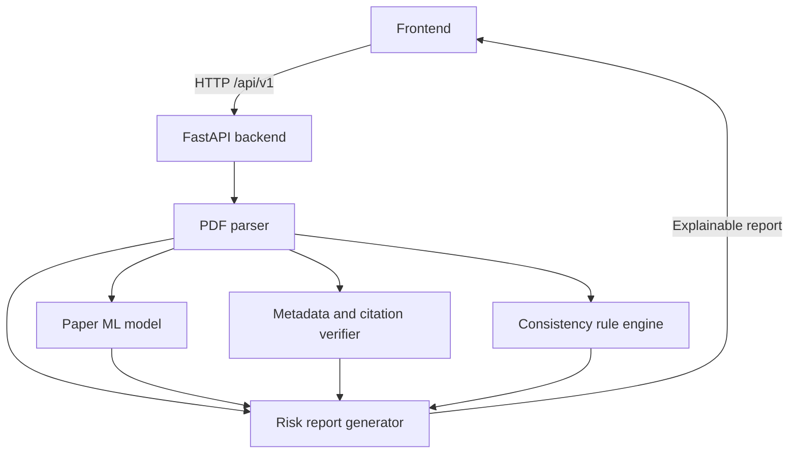

# Architecture

## Module status

| Module | Status |
| --- | --- |
| FastAPI backend | Implemented (health + PDF extraction) |
| PDF parser | Implemented (initial version: pages, text, DOI, abstract, references) |
| Paper ML model | Future work |
| Metadata and citation verifier | Future work |
| Consistency rule engine | Future work |
| Risk report generator | Future work |
| Frontend | Scaffolded (placeholder UI) |

## Design notes

- Route handlers stay thin; all PDF logic lives in `backend/app/services/pdf_parser.py`.
- Future modules expose typed Pydantic schemas matching `docs/api-contract.md` and report `pending` until implemented.
- Every report item must reference extracted evidence; the report generator (future) combines module signals into risk indicators, never a verdict.
